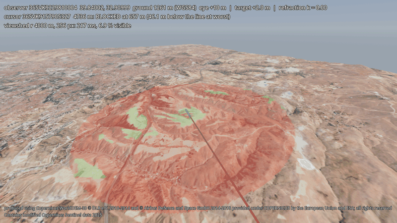

# godot-geo

Real-world terrain for Godot 4 from open data (Copernicus DEM, Sentinel-2, ESA WorldCover, OpenStreetMap) or your
own DTED / GeoTIFF files, in a WGS84-based local frame shared with godot-dis (DIS, IEEE 1278.1): water, land cover
detail, trees, buildings and roads, with line-of-sight and viewshed queries that see them.

> **Status:** in development, not released yet. APIs may change before v0.1.0.



<sub>Contains modified Copernicus Sentinel data 2025. Elevation produced using Copernicus WorldDEM-30 © DLR e.V.
2010-2014 and © Airbus Defence and Space GmbH 2014-2018 provided under COPERNICUS by the European Union and ESA; all
rights reserved.</sub>

## Scope
- **Offline at run time.** The addon reads a package from disk; no account, API key or network. The package builder
  needs the network only to download open data, and builds from local DTED / GeoTIFF files with `--offline`.
- **Heights in the DIS frame.** Package heights are relative to the WGS84 ellipsoid, with the EGM2008 (or EGM96)
  geoid and Earth curvature applied, so entities placed from DIS ECEF positions stand on the ground.
- **One surface.** The drawn surface, `height_at`, the collision shape and the visibility queries use the same
  triangulation of the height grid.
- **Generated, not photographed.** Buildings, trees and roads are built from open vector and raster data (footprints,
  heights, land cover, canopy height), not from photogrammetry: recognisable streets and skylines, not facades.
- **Not covered:** streamed 3D Tiles (photogrammetry, Cesium ion, Google Photorealistic; see 3D Tiles for Godot),
  editable game terrain with painting and foliage (see Terrain3D), streaming of areas larger than one package.

## Features
- **Package builder** (`tools/build_terrain.py`, Python): resamples elevation and colour onto the local ENU grid of
  an origin (geoid and Earth curvature applied) and writes a package: `height.exr`, `color.png`, `terrain.json`
  ([format](docs/package-format.md)). Sources: Copernicus DEM GLO-30 and cloud-free Sentinel-2 L2A (downloaded),
  or your own DTED (`.dt0/.dt1/.dt2`, read by a small numpy-only reader) and GeoTIFF files in any CRS, with EGM2008,
  EGM96 or ellipsoidal heights; colour from GeoTIFF imagery or an offline hillshade
  ([own data](docs/own-data.md)). Any latitude, and areas across 180° longitude.
- **`GeoTerrain` node** (GDScript, engine APIs only): loads a package and draws it with a CDLOD renderer
  (quadtree level of detail with geomorphing).
- **Layers** (optional, `--layers water,landcover,canopy,buildings,roads`): sea and lakes from OpenStreetMap
  coastlines with waves near the camera; ESA WorldCover land cover driving detail textures; trees from land cover and
  ETH canopy height; buildings from OpenStreetMap / Overture footprints with heights (tags, levels, GHSL estimates),
  roof shapes and windows, an approximate bare-earth ground under them; roads and bridges from OpenStreetMap. Each is
  a node that streams around the camera ([layers](docs/geo-terrain.md#layers)); military areas are never included.
  Positions follow the open data closely, most building heights are estimates
  ([how close to reality](docs/city.md#how-close-to-reality)).
- **City demo** (`demo/city.tscn`): Üsküdar, Istanbul, with camera bookmarks, a scripted check and a benchmark
  ([city view](docs/city.md)).
- **Queries:** `height_at(x, z)`, `geodetic_height(lat, lon)`, conversions between geodetic and scene positions.
- **`GeoMath`:** standalone WGS84 geodetic / ECEF / ENU / Godot, UTM and MGRS conversions in double precision.
- **Visibility:** `line_of_sight(a, b)` (visible, first obstruction and what it is: terrain, building or tree,
  clearance, optional refraction), `raycast(from, dir)`, `viewshed(observer, radius)` as an image, `set_overlay` to
  show it on the terrain ([details](docs/geo-terrain.md#visibility-queries)).
- **Collision:** a `HeightMapShape3D` patch that follows the camera or a given node.
- **godot-dis integration:** alignment with `DisGeoOrigin`; `DisEntityManager.ground_path` places remote land
  entities on the terrain.

## Requirements
- Godot 4.7 (the addon uses engine APIs available since 4.3, untested there). Tested on Windows and Linux with the
  Forward+, Mobile and Compatibility renderers; macOS not yet. Details: [compatibility table](docs/compatibility.md).
- For building packages: Python 3.12+ and the packages in `tools/requirements.txt` (rasterio, pyproj, pymap3d,
  numpy, OpenEXR, Pillow, pyarrow, shapely). These are build-time tools only; nothing of them is in the addon.
  Downloading open data uses public buckets and servers without an account or key (Copernicus DEM, Earth Search,
  ESA WorldCover, Overture Maps, ETH canopy height, GHSL, the PROJ CDN); downloads are cached, and building from
  your own files or the cache works offline.

## Installation
From the [releases page](https://github.com/OWNER/godot-geo/releases):
- `godot-geo-<version>.zip`: unzip into your project; it contains `addons/geo/`. No plugin needs to be enabled; the
  classes are global.
- Prebuilt terrain packages, each unzipping to `terrain/<name>/` with an `ATTRIBUTION.txt`:
  `godot-geo-terrain-ankara-40km.zip` (40 × 40 km at 10 m, 90 MB) and `godot-geo-terrain-samples.zip` (three
  3 km test packages: Ankara, Fiji across 180°, Norway at 70° N).

Or copy `addons/geo/` from a clone of this repository. [Getting started](docs/getting-started.md) goes from an empty
project to terrain with a line-of-sight query step by step.

## Usage
Build a package (40 × 40 km around Ankara at 10 m; about 30 s once the downloads are cached):
```sh
python -m venv tools/.venv
tools/.venv/Scripts/python -m pip install -r tools/requirements.txt     # bin/python on Linux and macOS
tools/.venv/Scripts/python -I tools/build_terrain.py --lat 39.9334 --lon 32.8597 --size 40000 --spacing 10 --out terrain/ankara
```
Or from your own files, without network access ([details](docs/own-data.md)):
```sh
tools/.venv/Scripts/python -I tools/build_terrain.py --fetch-geoid      # once, on a connected machine
tools/.venv/Scripts/python -I tools/build_terrain.py --lat 39.93 --lon 32.86 --size 21000 --spacing 30 \
    --dem path/to/dted --imagery hillshade --attribution "<data notice>" --offline --out terrain/mine
```
Load it:
```gdscript
var terrain := GeoTerrain.new()
terrain.package_path = "res://terrain/ankara"
add_child(terrain)

var y := terrain.height_at(x, z)                   # surface height at a scene position
var h := terrain.geodetic_height(39.95, 32.80)     # WGS84 ellipsoidal height of the ground

var los := terrain.line_of_sight(eye, target)      # {visible, point, distance, clearance, ...}
var img := terrain.viewshed(eye, 3000.0)           # visible / hidden ground within 3 km
terrain.set_overlay(GeoVisibility.viewshed_colors(img), terrain.viewshed_rect(eye, 3000.0))
```
Anything that shows the terrain must show the data attribution: `terrain.attribution()`.

Limits: one package at a time, no streaming; packages are read from the file system; queries are GDScript
(a 256² viewshed takes 0.3–1.4 s, run it on a worker thread).

## Demos
- `demo/city.tscn`: Üsküdar, Istanbul, with water, ground detail, trees, buildings and roads; camera bookmarks,
  `--check`, `--bench` ([city view](docs/city.md), [screenshots](docs/city/sheet.jpg)).
- `demo/terrain_view.tscn`: terrain with sun, sky and haze; free camera.
- `demo/visibility.tscn`: line of sight to the point under the mouse, viewshed overlay around an observer, `--check`
  report ([screenshot](docs/visibility/viewshed.jpg)). `demo/visibility_tour.tscn` is a scripted run of it that
  recorded the animation above.
- `demo/dis3d.tscn`: a DIS exercise in 3D with godot-dis and godot-milsymbol, with debug and test tools
  ([screenshot](docs/demo3d/overview.jpg)). Setup: [docs/demo-3d.md](docs/demo-3d.md).

## Documentation
- [Getting started](docs/getting-started.md): empty project to terrain and line of sight in about 15 minutes
- [GeoTerrain API and renderer](docs/geo-terrain.md)
- [Packages from your own data](docs/own-data.md) (DTED, GeoTIFF, vertical datum, offline use)
- [Terrain package format](docs/package-format.md)
- [City view](docs/city.md) (Üsküdar packages, bookmarks, check and benchmark)
- [3D DIS demo](docs/demo-3d.md)
- [Compatibility](docs/compatibility.md) (tested Godot versions and platforms)
- [Phase 0 findings](docs/phase0.md) (data sources, vertical datum, renderer comparison)
- [Plan](PLAN.md) (in Turkish) and [changelog](CHANGELOG.md)

## Development
```sh
godot --headless --path . --import
godot --headless --path . -s addons/gut/gut_cmdln.gd                        # Godot tests (GUT)
tools/.venv/Scripts/python -m pytest tests/python -q -p no:cacheprovider     # package builder tests
```
The Python tests compare packages with independent references (GDAL sampling, PROJ geoid grid, pymap3d golden
data). See [CONTRIBUTING.md](CONTRIBUTING.md).

Release assets (into `build/release/`, not in git; CI attaches them to a draft release on `v*` tags):
```sh
tools/.venv/Scripts/python -I tools/package_release.py --version 0.1.0 --terrain     # addon, terrain zips, SHA256SUMS
python tools/check_package.py build/release/godot-geo-0.1.0.zip build/release/godot-geo-terrain-samples.zip --godot <godot>
```
`tools/check_package.py` installs the zips into a new, empty project and runs the queries there.

## Contributing
Bug reports, questions and pull requests are welcome. Please read [CONTRIBUTING.md](CONTRIBUTING.md) and the
[code of conduct](CODE_OF_CONDUCT.md).

## License
MIT, see [LICENSE](LICENSE). The addon contains no third-party code or assets; GDAL, PROJ and the other Python
packages are used by the build tool only. Terrain data is not part of this repository (except four small test
packages) and is subject to its own terms: Copernicus DEM licence, Copernicus Sentinel data policy, CC BY 4.0 (ESA
WorldCover, ETH canopy height, GHSL), and the Open Database License for layers derived from OpenStreetMap (water,
buildings, roads: "© OpenStreetMap contributors, Overture Maps Foundation"). Packages carry the required
attribution and the demos show it. See [THIRD_PARTY_NOTICES.md](THIRD_PARTY_NOTICES.md).
