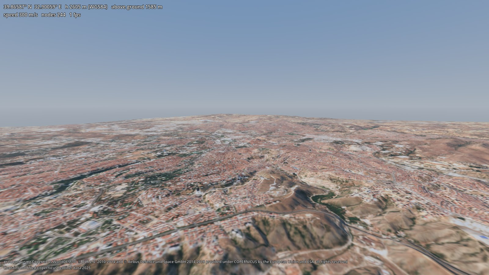

# godot-geo

Real-world terrain for Godot 4 from open data — Copernicus DEM elevation and Sentinel-2 imagery — in the same
coordinate system as [godot-dis](../godot-dis) (WGS84 → local ENU → Godot), so DIS entities sit on the right ground.

> 🚧 Phase 2 done: `GeoTerrain` node with its own CDLOD renderer, height queries and collision, on a 40 × 40 km
> Ankara package. Next: godot-dis integration and a 3D demo. See [PLAN.md](PLAN.md).



<sub>Contains modified Copernicus Sentinel data 2025. Elevation produced using Copernicus WorldDEM-30 © DLR e.V.
2010-2014 and © Airbus Defence and Space GmbH 2014-2018 provided under COPERNICUS by the European Union and ESA; all
rights reserved.</sub>

## How it works
1. **Build a package offline** (Python, `tools/`): downloads the DEM tiles and a cloud-free Sentinel-2 scene,
   resamples them onto the local ENU grid at the chosen origin (EGM2008 geoid and Earth curvature included) and writes
   `height.exr`, `color.png` and `terrain.json` ([format](docs/package-format.md)).
   ```
   tools/.venv/Scripts/python.exe -I tools/build_terrain.py --lat 39.9334 --lon 32.8597 --size 40000 --spacing 10 --out terrain/ankara
   ```
2. **Load it in Godot** with the `GeoTerrain` node (`addons/geo/`, GDScript only, no Python or GDAL at run time):
   ```gdscript
   $GeoTerrain.package_path = "res://terrain/ankara"
   var y := $GeoTerrain.height_at(x, z)                       # surface height, matches the picture and collision
   var h := $GeoTerrain.geodetic_height(39.95, 32.80)         # WGS84 ellipsoidal height of the ground
   ```
   Details: [docs/geo-terrain.md](docs/geo-terrain.md).

Demo: `res://demo/terrain_view.tscn` (free camera; right mouse + WASD, 1–6 views, F to walk on the ground).

## License
MIT. Terrain data is not part of this repository (except a 3.6 km test package); packages carry the attribution
required by each source (Copernicus DEM, Copernicus Sentinel data), and anything that shows the terrain must show it.
See [THIRD_PARTY_NOTICES.md](THIRD_PARTY_NOTICES.md).
