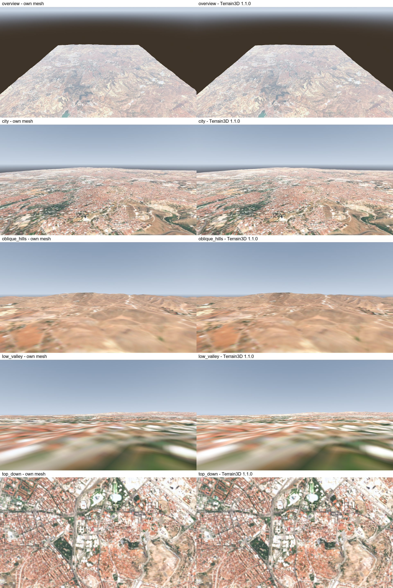

# godot-geo

Real-world terrain for Godot 4 from open data — Copernicus DEM elevation and Sentinel-2 imagery — in the same
coordinate system as [godot-dis](../godot-dis) (WGS84 → local ENU → Godot), so DIS entities sit on the right ground.

> 🚧 Phase 0 (exploration) done: data sources, vertical datum and geoid verified; two renderers compared on a
> 40 × 40 km Ankara prototype. See [docs/phase0.md](docs/phase0.md) and [PLAN.md](PLAN.md).

Contains modified Copernicus Sentinel data 2025. Elevation produced using Copernicus WorldDEM-30 © DLR e.V.
2010-2014 and © Airbus Defence and Space GmbH 2014-2018 provided under COPERNICUS by the European Union and ESA; all
rights reserved.

## License
MIT. Terrain data is not part of this repository; packages built by the tools carry the attribution required by
each source (Copernicus DEM, Copernicus Sentinel data) — see THIRD_PARTY_NOTICES.md once data is used.
