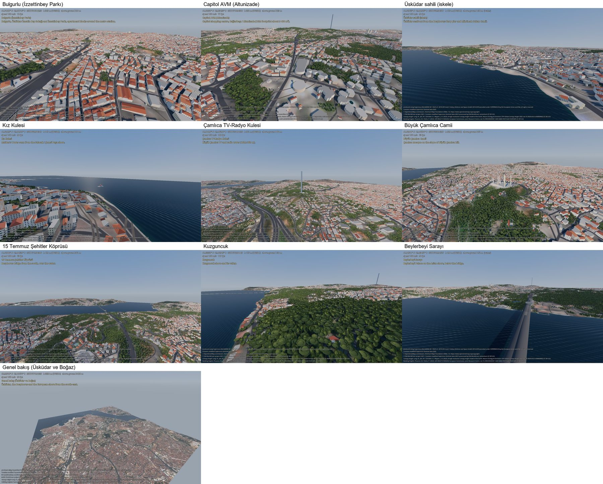

# City view (Üsküdar, Istanbul)

`demo/city.tscn` shows a terrain package with all its layers (water, ground detail, buildings, roads, trees) and
jumps between named camera bookmarks, so the picture can be compared with places one knows. The default area is
Üsküdar on the Asian shore of the Bosphorus. Everything was built and checked on a 10 × 10 km package first, then
on 60 × 60 km.



## Packages
Both packages share one origin, 41.0200 N 29.0500 E (ellipsoidal height 0), so scene coordinates do not change
between them. Commands from the repository root (Git Bash; see the README for the virtual environment):

```bash
tools/.venv/Scripts/python.exe -I tools/build_terrain.py --lat 41.02 --lon 29.05 --size 10000 --spacing 5 \
    --color-spacing 10 --scene S2A_35TPF_20250722_0_L2A --layers water,landcover,canopy,buildings,roads \
    --water-spacing 2.5 --out terrain/uskudar_10km
tools/.venv/Scripts/python.exe -I tools/build_terrain.py --lat 41.02 --lon 29.05 --size 60000 --spacing 10 \
    --color-spacing 10 --scene S2A_35TPF_20250722_0_L2A --layers water,landcover,canopy,buildings,roads \
    --water-spacing 10 --out terrain/uskudar
```

The first run downloads (no account, no key): Copernicus DEM tiles, a Sentinel-2 window, an ESA WorldCover and an
ETH canopy height window, a GHSL building height window, and the Overture Maps rows of the area (water, land use,
buildings, building parts, transportation; read from Overture's public bucket with pyarrow, or from a local
OpenStreetMap extract with `--osm-pbf`, see [own data](own-data.md)). Everything is cached
in `tools/.cache/`; later runs and `--offline` need no network. The 10 km package takes about 3 minutes the first
time and 30 s from the cache; heights 5 m (from the 30 m DEM), colour 10 m, water mask 2.5 m.

`tests/data/uskudar_small` (3 km around the Üsküdar seafront, origin 41.024 N 29.012 E) is the committed test
package: `--lat 41.024 --lon 29.012 --size 3000 --spacing 15 --color-spacing 15
--layers water,landcover,canopy,buildings,roads --water-spacing 7.5`.

## Running
```bash
<godot> --path . res://demo/city.tscn [-- --package <dir>] [--place <id>] [--detail 0..1]
<godot> --path . res://demo/city.tscn -- --tour --out <dir>
<godot> --path . res://demo/city.tscn --resolution 1920x1080 -- --check [--report x.json]
<godot> --path . res://demo/city.tscn --resolution 1920x1080 -- --bench x.json
tools/.venv/Scripts/python.exe demo/places_sheet.py <dir> <dir>/sheet.jpg [--only-checks]
```

| Key | |
|---|---|
| right mouse + WASD, Q / E | fly; Shift = 5× faster, mouse wheel = speed |
| Tab | bookmark list (click to go) |
| 1–9, 0 | bookmarks in list order |
| PgUp / PgDn | previous / next bookmark |
| G / F | drop to 2 m above the ground / walk on the ground |
| F3 | position (WGS84, MGRS), height above ground, water, frame rate |
| F12 | screenshot to `user://` |

- `--tour` visits every bookmark inside the package, builds the layers around it, saves `<id>.png` and
  `stats.json` (frame time, primitives, draw calls, layer counts, video memory) and quits.
- `--check` (meant for `terrain/uskudar_10km` or the 60 km package; on the 3 km test package the lines of sight
  that leave it are skipped) loads the layers around the three reference views, measures 120 frames at each (p50 / p95 / p99), and
  tests lines of sight with known answers: from above the Çamlıca TV tower to above Kız Kulesi (visible), from 40 m
  above the water to a street behind the Üsküdar seafront (hidden by buildings, visible over bare terrain), from
  Bulgurlu to Capitol at street level (hidden), across the Bosphorus (visible). Exit code 1 on a problem.
- `--bench` flies a fixed route (seafront, Capitol, Bulgurlu, Çamlıca, back over the Bosphorus) at 150 m and 500 m
  above the ground with streaming on and writes frame time percentiles, slow frames, draw calls, primitives and the
  longest layer update.

## Bookmarks
`demo/places.json`: id, name, target point (latitude, longitude, `target_height` above the ground), camera heading
(degrees from north), pitch (negative = down) and distance. Positions come from OpenStreetMap through Overture Maps
(building footprints where possible: Capitol shopping centre, Büyük Çamlıca mosque, the TV tower). Three are the
reference views for visual checks (`"check": true`): Bulgurlu (İzzettinbey Parkı), Capitol shopping centre in
Altunizade, and the Üsküdar seafront. The others: Kız Kulesi, the Küçük Çamlıca TV tower, Büyük Çamlıca mosque, the
15 Temmuz Şehitler bridge, Kuzguncuk, Beylerbeyi Palace and an overview. Military sites are never bookmarked, and
their buildings are not in the packages.

## How close to reality
The packages are built only from open data, without surveying anything by hand. What that gives:

| | Source | Fidelity |
|---|---|---|
| Building positions and outlines | OpenStreetMap, Overture Maps (incl. Microsoft ML footprints) | traced from aerial imagery: blocks, streets and squares are where they are on a map |
| Roads, bridges, shoreline | OpenStreetMap | as mapped; road surfaces are painted on the ground (no kerbs, pavement edges or street furniture); suspension bridge towers and cables are generated from the mapped tower and deck heights, a simplified shape |
| Ground shape | Copernicus DEM 30 m, resampled to 5 m | hills, slopes and valleys are right; steps, retaining walls and cuttings narrower than ~30 m are not there |
| Building heights | OSM `height` / `building:levels` for ~8 %, GHSL 100 m average for ~91 % | the skyline of a neighbourhood is close; a single building can be several floors off (see below) |
| Building look | own procedural walls, windows and roofs | a landmark is recognisable by position and mass, not by facade or signage |
| Trees | ETH canopy height 10 m, ESA WorldCover | where and how tall the canopy is; trees are generic, placed deterministically |

**Building heights.** In Istanbul almost no building has a height in open data, and Microsoft's footprints carry no
height for Türkiye, so most heights come from GHSL GHS-BUILT-H: the average building height of each 100 × 100 m
cell, varied slightly per building. On average it holds: across the 1 596 tagged buildings of the 60 km package the
GHSL median is 15.0 m against 15.7 m from the tags. Within one cell, though, a two-storey house next to a ten-storey
block gets a similar height. Every height added to OpenStreetMap (`height` or `building:levels`) is used the next
time a package is built.

**Walking around.** `F` puts the camera on the ground; the whole 10 km package (roughly Kadıköy to Beylerbeyi,
Harem to the east of Çamlıca) can be walked. The demo turns on `collision_buildings`, so the walker stops at
walls (a 0.4 m sphere at eye height, `PhysicsDirectSpaceState3D.cast_motion`; 198 of 201 automated walks into
buildings stopped, the other three are on the Çamlıca slope where the approximate ground under the building rises
to its roof). Tree crowns have no collision; `line_of_sight`, `raycast` and `viewshed` see buildings and trees.

In short: from 100–500 m above the ground the area is recognisable and good enough for simulation and line of
sight work; at street level the layout is right, the heights and looks of single buildings are approximate.

## Measurements
10 km package, 1920 × 1080, RTX 4080, Windows, all layers (`--bench`): median frame 2.0 ms, p99 7.1 ms at 150 m and
7.6 ms at 500 m above the ground; 5–6 frames per run over 33 ms (when the far road ring moves, once per 2 km).
Load 0.2 s; layers stream in over the first second. Details and the 60 km numbers: [geo-terrain.md](geo-terrain.md#layers).
