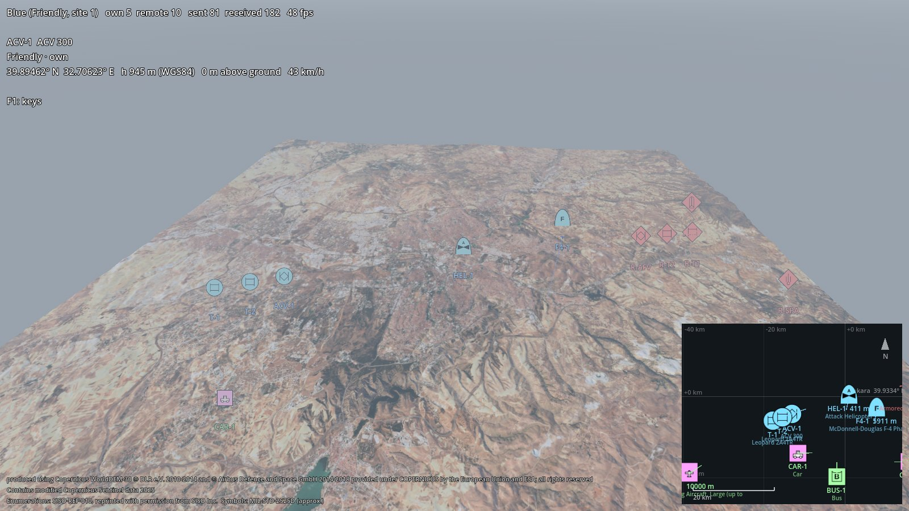
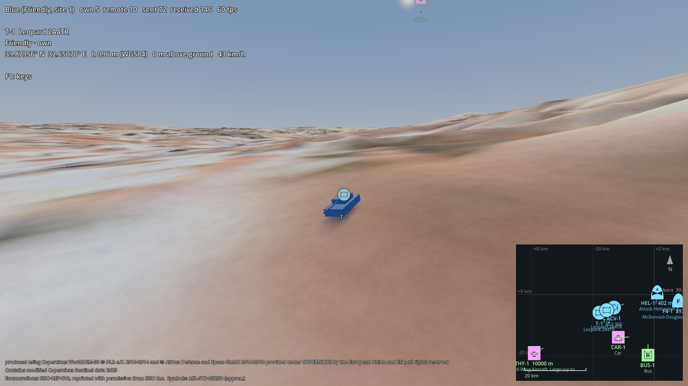
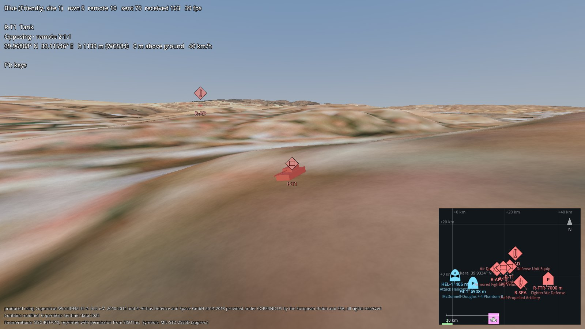
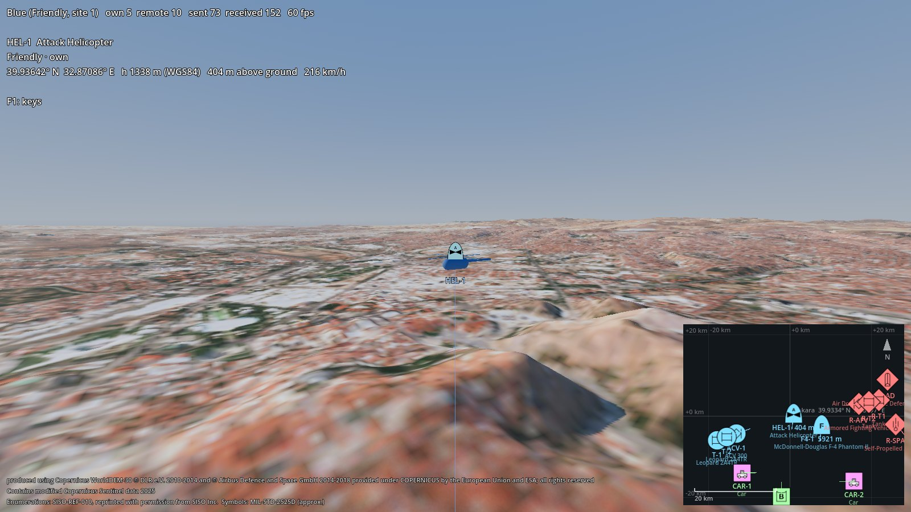
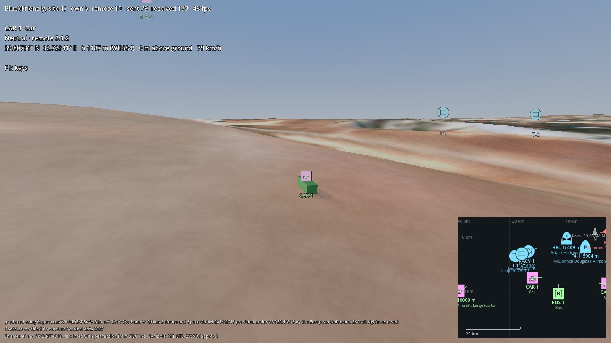
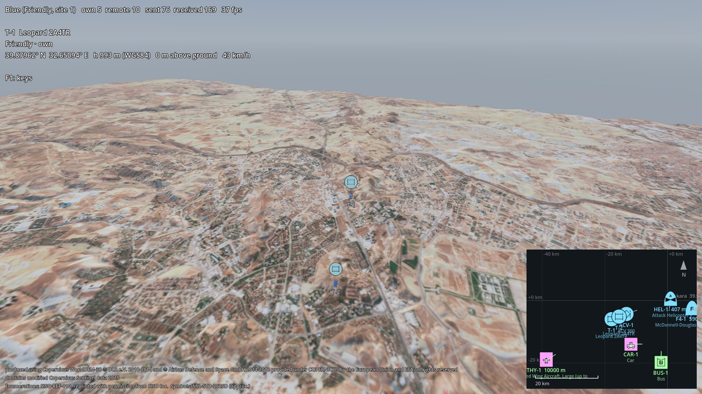

# 3D DIS demo

`demo/dis3d.tscn` is one participant of the godot-dis two-sided exercise around Ankara, shown in 3D on real terrain.
It publishes its own units with godot-dis `DisEntity` and shows everything else on the network: the other side (the
godot-dis 2D demo, or a second 3D copy) and civilian traffic sent by an independent DIS implementation
(Open-DIS Python). Units are simple models plus MIL-STD-2525 symbols (godot-milsymbol); the godot-dis tactical map
is the minimap.



## Setup (once)
The demo uses the sibling repositories of the workspace; `tools/link_siblings.py` links them in as directory
junctions (git-ignored): `addons/dis`, `addons/milsymbol` and `demo/dis` (the godot-dis demo's scenario, unit mover
and tactical map, so both demos run the same exercise).

```powershell
cd path\to\godot-geo
.\tools\.venv\Scripts\python.exe tools\link_siblings.py
.\tools\.venv\Scripts\python.exe -I tools\build_terrain.py --lat 39.9334 --lon 32.8597 --size 60000 --spacing 15 --out terrain\ankara_60km
```
godot-dis must be built (`addons/dis/bin`). The exercise spans about ±27 km, hence the 60 km package; without it the
demo falls back to `terrain/ankara` (40 km) and units beyond its edge keep their reported height.

## Run
Blue in 3D, red in the godot-dis 2D demo, civilian traffic from Python (three terminals):
```powershell
cd path\to\godot-geo; & "C:\path\to\godot.exe" --path . res://demo/dis3d.tscn -- --side blue
cd path\to\godot-dis; & "C:\path\to\godot.exe" --path . res://demo/main.tscn -- --side red
cd path\to\godot-dis; .\tools\.venv\Scripts\python.exe tools\demo_traffic.py
```
## Keys
| Key | |
|---|---|
| Tab / Shift+Tab | next / previous unit (the camera orbits it, the minimap follows) |
| left drag, wheel | orbit, zoom |
| C | free camera: right mouse to look, WASD, Q / E down / up, Shift fast |
| [ / ] | own units half / double speed (×1/8 … ×16); P pauses them |
| PgUp / PgDn | move the selected own unit 1 km along its route |
| F3 | debug overlay: frame time, triangles, terrain nodes, network counters, entity ID, dead reckoning algorithm, PDU age, ground clamp, largest frame-to-frame jump |
| F9 | start / stop a CSV log of every unit (10 Hz) in the Godot user folder |
| F12 | screenshot to the Godot user folder |
| F1 | key help |

Time scale and pause act on own units only: remote units move on their own simulations' clocks (DIS has no shared
pause), and a paused side stops its heartbeats, so the others drop its units after 12 s.

## Testing tools
Options after `--`:
- `--port N`: a separate exercise, so tests do not mix with a demo already running (all participants take
  `--port`; the godot-dis 2D demo and `demo_traffic.py` too).
- `--log file.csv`: CSV of every unit at 10 Hz (time, position, height above ground, speed, heading, PDU age).
- `--check N`: runs N seconds, then prints a report per unit and exits with code 1 if anything looks wrong:
  `jump` (moved farther than its speed allows), `reverse` (moved against its heading), `buried` / `floating`
  (land unit below / above the terrain by more than 0.5 m), `low` (aircraft below 50 m), `gap` (no PDU for 6 s);
  plus frame times. `--report file.json` saves the details.
- `--shots dir [--warmup s]`: the screenshots of this document.
- `demo_traffic.py --start S` skips S seconds ahead (the airliner's first turn is ~400 s in), `--rate HZ` changes
  the update rate.

A full self-check, on port 3200 so it does not disturb a running demo (two terminals):
```powershell
cd path\to\godot-dis; .\tools\.venv\Scripts\python.exe tools\demo_traffic.py --port 3200 --start 385 --seconds 90
cd path\to\godot-geo; & "C:\path\to\godot.exe" --path . res://demo/dis3d.tscn -- --port 3200 --check 60
```
```
check: 9 units, 490 samples
  THY-1  remote  air  off terrain  OK
  CAR-1  remote  land agl -0.0..0.0 m  OK
  ...
check: no problems
frames: 1321, mean 16.67 ms, 99th percentile 18.77 ms, worst 19.46 ms
```
This found two bugs before release: the airliner reversed on the spot at the end of a back-and-forth route (now a
racetrack), and godot-dis smoothing started from the previous frame's pose, so every update made fast entities stall
for a frame and catch up (fixed in godot-dis).

## How the units meet the ground
- **Own units:** `DemoUnitMover.ground = GeoTerrain`. Land units drive on `height_at` and tilt with the slope;
  aircraft keep at least 150 m above the ground. `DisEntity` publishes the result, so other simulations see the units
  on our terrain.
- **Remote units:** `DisEntityManager.ground_path = GeoTerrain`. Land platforms, life forms and cultural features are
  put on the local terrain and tilted to it (heading kept); aircraft keep their reported height. The 2D demo and the
  Python traffic send land units at the height of the tangent plane, so without the clamp they would be up to
  hundreds of metres under or above the hills.
- **Alignment:** the scene's `DisGeoOrigin` (39.9334, 32.8597, 938 m) has the package origin's latitude and longitude
  but another height, so `GeoTerrain` shifts the terrain by −938 m automatically (see geo-terrain.md).

## Views
| | |
|---|---|
|  own tank on the terrain |  red tank from the 2D demo, clamped |
|  helicopter with its ground line |  civilian traffic from Open-DIS Python |
|  own tanks from 6 km | |

<sub>Contains modified Copernicus Sentinel data 2025. Elevation produced using Copernicus WorldDEM-30 © DLR e.V.
2010-2014 and © Airbus Defence and Space GmbH 2014-2018 provided under COPERNICUS by the European Union and ESA; all
rights reserved. Enumerations: SISO-REF-010, reprinted with permission from SISO Inc.</sub>
