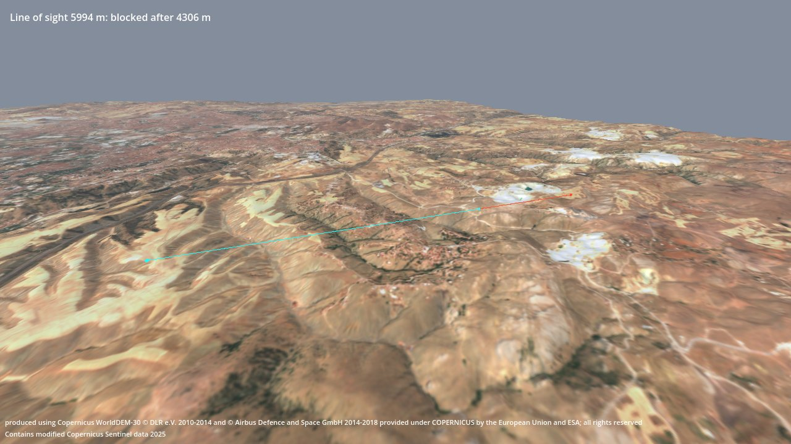
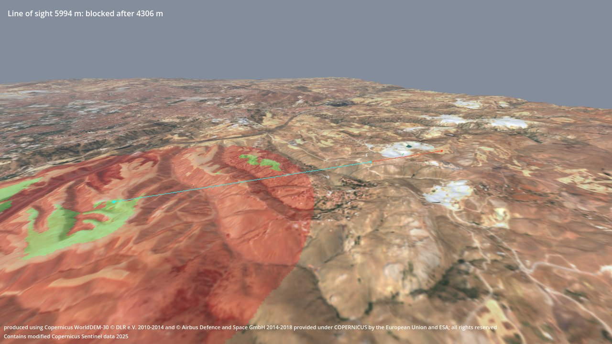

# Getting started

From an empty Godot project to real terrain on screen with a line-of-sight query, in about 15 minutes. You need
no Python and no network access after the download.



## What you need
- Godot 4.7 (standard build; the .NET build works too). Any renderer: Forward+, Mobile or Compatibility.
- From the [releases page](https://github.com/OWNER/godot-geo/releases), two files of the same release:
  - `godot-geo-<version>.zip`: the addon (25 KB).
  - `godot-geo-terrain-ankara-40km.zip`: a prebuilt terrain package, 40 × 40 km around Ankara at 10 m (90 MB).
    For a quick try there is also `godot-geo-terrain-samples.zip` (0.3 MB, three 3 km packages); see
    [Using the small sample package](#using-the-small-sample-package).

`SHA256SUMS.txt` on the same page lists the checksums of the files.

## 1. Create a project
1. Start Godot. In the Project Manager click **Create**, give the project a name, choose a folder, keep the
   renderer **Forward+**, and click **Create** (older versions: **Create & Edit**). The editor opens.
2. In the **FileSystem** dock (bottom left), right-click `res://` and choose **Open in File Manager**. This is the
   project folder.

## 2. Add the addon and the terrain
Unzip both downloads into the project folder, so that it looks like this:
```
project.godot
addons/geo/            geo_terrain.gd, geo_math.gd, geo_visibility.gd, ...
terrain/.gdignore
terrain/ankara/        terrain.json, height.exr, color.png, ATTRIBUTION.txt
```
Each zip already contains the `addons/` or `terrain/` folder: extract them *into* the project folder, not into a
new folder named after the zip (Windows' "Extract All" suggests one; remove the zip name from the path). On Linux
and macOS: `unzip godot-geo-<version>.zip -d <project folder>`, the same for the terrain zip.

Switch back to the editor. It scans the new files; `addons/geo` appears in the FileSystem dock, `terrain` does not
(the `.gdignore` file keeps the editor from importing 90 MB of package files; `GeoTerrain` reads them directly).
No plugin has to be enabled: the classes `GeoTerrain`, `GeoMath` and `GeoVisibility` are available at once.

## 3. A scene with a script
1. In the **Scene** dock click **3D Scene**. A root node `Node3D` appears.
2. Right-click it, choose **Attach Script**, keep the suggested path (or call it `main.gd`), click **Create**.
3. Replace everything in the script editor with:

```gdscript
extends Node3D

const OBSERVER := Vector2(39.8400, 32.9100)  # latitude, longitude (degrees)
const TARGET := Vector2(39.8400, 32.9800)
const MAST := 10.0  # observer's eye above the ground, metres
const TARGET_HEIGHT := 2.0

var terrain: GeoTerrain


func _ready() -> void:
	# 1. The terrain. Adding it to the tree loads the package.
	terrain = GeoTerrain.new()
	terrain.package_path = "res://terrain/ankara"
	add_child(terrain)

	# 2. Sun and sky.
	var sun := DirectionalLight3D.new()
	sun.rotation_degrees = Vector3(-35.0, -60.0, 0.0)
	sun.shadow_enabled = true
	add_child(sun)
	var env := Environment.new()
	env.background_mode = Environment.BG_SKY
	env.sky = Sky.new()
	env.sky.sky_material = ProceduralSkyMaterial.new()
	env.fog_enabled = true
	env.fog_density = 0.00002
	var world := WorldEnvironment.new()
	world.environment = env
	add_child(world)

	# 3. Line of sight from the observer's eye to the target.
	var eye := _ground(OBSERVER) + Vector3(0.0, MAST, 0.0)
	var target := _ground(TARGET) + Vector3(0.0, TARGET_HEIGHT, 0.0)
	var los := terrain.line_of_sight(eye, target)
	print(los)
	_add_line(eye, los.point, Color.CYAN)  # visible part
	if not los.visible:
		_add_line(los.point, target, Color.ORANGE_RED)  # hidden behind the first obstruction

	# 4. A camera looking at both ends.
	var camera := Camera3D.new()
	camera.far = 100000.0
	add_child(camera)
	var middle := (eye + target) / 2.0
	camera.look_at_from_position(middle + Vector3(-1000.0, 1800.0, 3500.0), middle)

	# 5. The result, and the data attribution (it must be shown wherever the terrain is shown).
	var hud := CanvasLayer.new()
	add_child(hud)
	var result := Label.new()
	result.position = Vector2(16.0, 16.0)
	result.text = "Line of sight %.0f m: %s" % [eye.distance_to(target),
			"visible" if los.visible else "blocked after %.0f m" % los.distance]
	hud.add_child(result)
	var attribution := Label.new()
	attribution.text = "\n".join(terrain.attribution())
	attribution.autowrap_mode = TextServer.AUTOWRAP_WORD_SMART
	attribution.add_theme_font_size_override("font_size", 11)
	hud.add_child(attribution)
	attribution.set_anchors_and_offsets_preset(Control.PRESET_BOTTOM_WIDE, Control.PRESET_MODE_MINSIZE, 8)


## Ground point at a latitude / longitude, in scene coordinates.
func _ground(lat_lon: Vector2) -> Vector3:
	var p := terrain.geodetic_to_global(lat_lon.x, lat_lon.y, 0.0)
	p.y = terrain.height_at(p.x, p.z)
	return p


## A line drawn on top of everything, with a ball at each end.
func _add_line(from: Vector3, to: Vector3, color: Color) -> void:
	var material := StandardMaterial3D.new()
	material.shading_mode = BaseMaterial3D.SHADING_MODE_UNSHADED
	material.albedo_color = color
	material.no_depth_test = true
	var mesh := ImmediateMesh.new()
	mesh.surface_begin(Mesh.PRIMITIVE_LINES, material)
	mesh.surface_add_vertex(from)
	mesh.surface_add_vertex(to)
	mesh.surface_end()
	var line := MeshInstance3D.new()
	line.mesh = mesh
	add_child(line)
	for p in [from, to]:
		var ball := MeshInstance3D.new()
		ball.mesh = SphereMesh.new()
		ball.scale = Vector3.ONE * 40.0
		ball.material_override = material
		ball.position = p
		add_child(ball)
```

4. Save the scene with **Ctrl+S** (macOS: **Cmd+S**) as `main.tscn`.
5. Press **F5** (macOS: **Cmd+B**) and, when asked for a main scene, click **Select Current**.

A window opens with the terrain south-east of Ankara (picture at the top). The cyan line runs from the observer's
eye, 10 m above the ground, to where it first touches the terrain; the red part is hidden behind that ridge. The
**Output** panel shows the full result:
```
{ "visible": false, "point": (8609.424, 1391.656, 10365.08), "distance": 4306.11376953125, "clearance": -49.1026022710305, ... }
```
`point` is the first obstruction in scene coordinates, `distance` how far from the eye it is, `clearance` the
lowest height of the line above the ground (negative: at worst 49 m below it). Loading the package takes a few
seconds before the window appears.

What the script used:
- `GeoTerrain` loads the package when it enters the scene tree. The scene origin is the package origin
  (39.9334° N, 32.8597° E); +X is east, −Z north, +Y up, in metres.
- `geodetic_to_global(lat, lon, height)` turns WGS84 coordinates into scene positions, `height_at(x, z)` gives the
  ground height there.
- `line_of_sight(a, b)` tests the straight line between two points against the same surface that is drawn and used
  for collision.
- `attribution()` returns the data notices. Copernicus data may be used freely, but these notices must be shown
  wherever the terrain is shown.

## 4. Add a viewshed
Add these lines at the end of `_ready()`:
```gdscript
	# 6. Viewshed: the ground within 3 km that the observer sees (green) or not (red).
	var image := terrain.viewshed(eye, 3000.0)
	terrain.set_overlay(GeoVisibility.viewshed_colors(image), terrain.viewshed_rect(eye, 3000.0))
```
Run again (F5). Green ground within 3 km of the observer is visible from the eye (for a target 2 m above the
ground), red ground is not:



`viewshed` takes about a second here, during which the game does not draw. In a real project, run
`GeoVisibility.viewshed` on a worker thread as `demo/visibility.gd` in the repository does.

Try other places: change `OBSERVER`, `TARGET` and `MAST` (the package covers 39.75–40.11° N, 32.63–33.09° E).

## Using the small sample package
`godot-geo-terrain-samples.zip` contains `terrain/ankara_small` (3.6 km around the same origin), `fiji_small`
(across 180° longitude) and `norway_small` (70° N). With it, change four lines of the script:
```gdscript
const OBSERVER := Vector2(39.9250, 32.8500)
const TARGET := Vector2(39.9420, 32.8700)
	terrain.package_path = "res://terrain/ankara_small"
	camera.look_at_from_position(middle + Vector3(-500.0, 900.0, 1800.0), middle)
```
and use a radius of 1500 instead of 3000 for the viewshed.

## Your own elevation data (DTED / GeoTIFF)
Packages are made by `tools/build_terrain.py` in the godot-geo repository. It needs Python 3.12 or newer and works
offline with your own files. In a clone of the repository (Windows paths; on Linux and macOS use
`tools/.venv/bin/python`):
```sh
python -m venv tools/.venv
tools/.venv/Scripts/python -m pip install -r tools/requirements.txt
tools/.venv/Scripts/python -I tools/build_terrain.py --fetch-geoid      # once, needs the network (geoid grids)
tools/.venv/Scripts/python -I tools/build_terrain.py --lat 39.93 --lon 32.86 --size 20000 --spacing 30 \
    --dem path/to/dted --imagery hillshade --attribution "Elevation: <your data notice>" --offline \
    --out <your project>/terrain/mine
```
`--dem` takes DTED cells (`.dt0/.dt1/.dt2`) or GeoTIFF files in any CRS, or a folder of them; `--imagery` a
GeoTIFF orthophoto or `hillshade`. Then set `terrain.package_path = "res://terrain/mine"`. Vertical datum, gaps
and other options: [own-data.md](own-data.md).

Without `--dem` and `--imagery` the builder downloads Copernicus DEM and Sentinel-2 for any place on Earth
(see the README).

## When something goes wrong
| Symptom | Cause |
|---|---|
| `GeoTerrain: no terrain package at res://terrain/ankara` | `terrain.json` is not at `terrain/ankara/terrain.json` in the project folder (often an extra folder level from unzipping). |
| `Identifier "GeoTerrain" not declared` | The addon is not at `addons/geo/` (same cause), or the editor has not finished scanning: wait, or reopen the project. |
| The editor imports `color.png` / `height.exr` for a long time | `terrain/.gdignore` is missing; create an empty file with that name. |
| Lines start or end in the air or underground | Points outside the package: `height_at` returns `NAN` there, and `line_of_sight` sets `partial`. |

## Next
- [GeoTerrain API](geo-terrain.md): properties, all queries, collision, alignment with godot-dis.
- The repository's demos: `demo/visibility.tscn` (line of sight under the mouse, viewshed on a thread, MGRS),
  `demo/terrain_view.tscn`, `demo/dis3d.tscn` (DIS entities on the terrain).
- [Package format](package-format.md) if you want to write packages with other tools.
