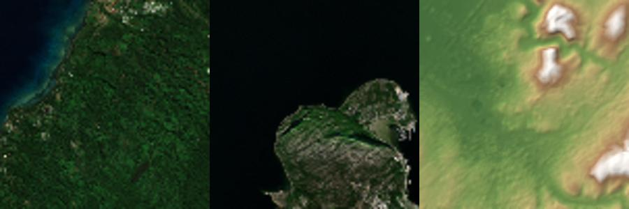

# Packages from your own data

`tools/build_terrain.py` downloads Copernicus DEM and Sentinel-2 by default. It can instead build a package from
elevation and imagery files you already have, without network access. The result is the same package format
([package-format.md](package-format.md)), so `GeoTerrain` cannot tell the difference.

## Examples
```sh
# DTED cells (a directory is searched recursively; .dt2 before .dt1 before .dt0), offline hillshade colour
tools/.venv/Scripts/python -I tools/build_terrain.py --lat 39.93 --lon 32.86 --size 21000 --spacing 30 \
    --dem D:/data/dted --imagery hillshade --attribution "Elevation: <your notice>" --offline --out terrain/mine

# A GeoTIFF DEM in any CRS plus an orthophoto, gaps in the DEM filled from Copernicus DEM
tools/.venv/Scripts/python -I tools/build_terrain.py --lat 39.93 --lon 32.86 --size 10000 --spacing 10 \
    --dem dem_utm36.tif --dem-fallback copernicus --imagery ortho.tif --out terrain/mine
```
Run `python -I tools/build_terrain.py --help` for all options.

## Elevation (`--dem`)
- **Files:** DTED level 0/1/2 (`.dt0`, `.dt1`, `.dt2`) or GeoTIFF (`.tif`, `.tiff`, first band, any CRS PROJ knows).
  `--dem` is repeatable and accepts directories. Files are used in the order given: a sample takes its height from
  the first file that covers it. Only the part of each file around the area is read.
- **DTED** is read by `tools/dted.py`, a small numpy-only reader written from MIL-PRF-89020B (no GDAL): header
  records, signed-magnitude posts, voids (−32767) as no data, record checksums (a mismatch is reported, not fatal),
  longitude spacing from the header (it grows above 50° latitude). It is tested post by post against GDAL's DTED
  driver. The horizontal datum must be WGS84.
- **No-data:** GeoTIFF nodata / masks and DTED voids are holes. If any sample of the grid is not covered, the build
  stops and says where; `--dem-fallback copernicus` fills holes from Copernicus DEM (downloaded or cached),
  `--dem-fallback zero` with 0 m above the geoid (sea level).

### Vertical datum
Package heights are ellipsoidal (WGS84), like DIS positions, so the builder adds the geoid height *N* to
orthometric DEM heights. `--dem-vertical` says what the files hold:

| Value | Meaning | Geoid grid (PROJ, NGA, public domain) |
|---|---|---|
| `auto` (default) | DTED: EGM96 (MIL-PRF-89020B "MSL"); GeoTIFF: from a compound CRS (e.g. `EPSG:4326+3855` = EGM2008, `+5773` = EGM96) or a 3D geographic CRS (ellipsoidal); otherwise EGM2008 is **assumed**, with a warning | |
| `egm2008` | heights above the EGM2008 geoid (Copernicus DEM, most recent products) | `us_nga_egm08_25.tif` (81 MB) |
| `egm96` | heights above the EGM96 geoid (DTED, SRTM) | `us_nga_egm96_15.tif` (2.7 MB) |
| `ellipsoid` | heights already above the WGS84 ellipsoid | none |

The two geoids differ by up to a few metres; using none where one is needed puts the ground 30–40 m off in Turkey.
`terrain.json` records the datum of every file and whether it was assumed.

## Colour (`--imagery`)
- **GeoTIFF files** (RGB or RGBA, or one grey band; any CRS), repeatable, first file first. 8-bit values are used as
  they are; other types are stretched linearly from `--imagery-range LO HI`, or from the 2nd–98th percentile of the
  area. Transparent or no-data pixels are holes; samples no file covers stay black (with a warning).
- **`--imagery hillshade`**: no imagery at all; the colour is a hillshade (light from the north-west) times an
  elevation tint, computed from the package heights. Useful offline and for checking a DEM.
- Without `--imagery`, Sentinel-2 L2A is downloaded as before.

## Attribution
Packages carry the notices their data requires in `terrain.json` (`attribution`), and `GeoTerrain.attribution()`
returns them for display. Copernicus notices are added only when Copernicus data was actually used (including as a
fallback). For your own files, pass the notice your licence requires with `--attribution "..."` (repeatable); the
builder reminds you when it is missing. `terrain.json` stores file names and SHA-256 hashes, never paths.

## Offline machines
Nothing in the addon uses the network; the builder only needs it to download data. With `--offline` it fails
instead of going online, and every build ends with `no network access` or a list of what was downloaded.
To prepare an offline machine:
1. On a connected machine: create the venv (`tools/requirements.txt`) and run
   `python -I tools/build_terrain.py --fetch-geoid`, which puts both geoid grids into `tools/.cache/geoid/`.
   For an offline pip install, `pip download -r tools/requirements.txt -d wheels` there and
   `pip install --no-index --find-links wheels -r tools/requirements.txt` on the target.
2. Copy the repository including `tools/.cache/geoid/` (or point `--geoid-grid` at a grid file anywhere).
3. Build with `--dem ... --imagery ... --offline`.
Copernicus DEM tiles and Sentinel-2 windows already in `tools/.cache/` also work offline.

## Licence boundary
GDAL (through rasterio), PROJ (through pyproj), numpy, OpenEXR and Pillow are used by the builder at development
time only, under their own permissive licences (MIT / BSD / Apache-2.0 style). None of their code is in
`addons/geo/`, and a package contains only an EXR, a PNG and a JSON file. The addon reads packages with Godot engine
APIs and has no native libraries. No GPL code is used anywhere (in particular not Geodot or GRASS GIS).

## Anywhere on Earth
- Copernicus DEM tiles get narrower towards the poles (3600 columns up to 50°, then 2400, 1800, 1200, 720 and 360
  columns at 50, 60, 70, 80 and 85°); every width is handled, including areas across a band edge. Tested at 70° N in
  northern Norway (`tests/data/norway_small`).
- Areas across 180° longitude work for DEM tiles, your own files and Sentinel-2 (the search is split in two).
  Tested on Taveuni, Fiji (`tests/data/fiji_small`).
- Sentinel-2: items of the original Earth Search collection that only point to requester-pays JPEG 2000 files are
  skipped; if no usable scene is left, Collection 1 (`sentinel-2-c1-l2a`) is searched.



<sub>Left to right: Taveuni across 180° and Alta across 70° N (contain modified Copernicus Sentinel data 2025),
Ankara as a hillshade. Elevation produced using Copernicus WorldDEM-30 © DLR e.V. 2010-2014 and © Airbus Defence and
Space GmbH 2014-2018 provided under COPERNICUS by the European Union and ESA; all rights reserved.</sub>

## Tests
`tests/python/test_dted.py` (reader against GDAL), `test_own_data.py` (packages from GeoTIFF copies of a Copernicus
tile, ellipsoidal heights, compound CRS, UTM, DTED written by GDAL, gaps and fallback, offline mode, imagery
sampling and stretching, hillshade) and `test_world.py` (tile widths, band edge, antimeridian). The oracle is GDAL's
bilinear resampling of the input files plus the PROJ geoid, at positions converted with PROJ independently of the
builder.
